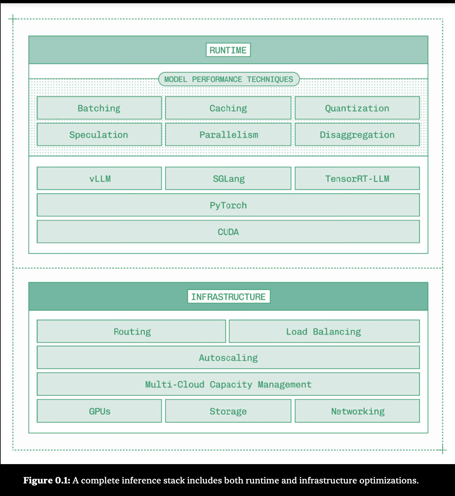
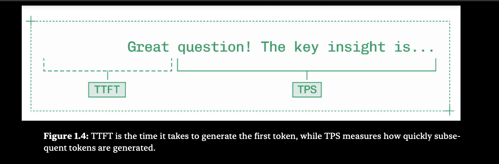

# InferenceEngineering101
Learning Inference Engineering from Basics

Inference is the second phase in a generative AI model's lifecycle:

Training: The process of learning model weights from data
Inference : Serving Generative AI models in production

Doing inference well requires three layers:
    
Runtime: Optimizing the performance of a single model on a single GPU-backed instance.
Infrastructure: Scaling across clusters, regions, and clouds without creating silos while maintaining excellent uptime.
Tooling: Providing engineers working on inference with the right level of abstraction to balance control with productivity.

These three layers must work together to create a system that can handle mission-critical inference at scale.”

An overview of the Inference Engineering:

“The runtime layer relies on a number of model performance techniques that apply new research to the unique challenges of inference on generative AI models:
    
# Batching: Run incoming requests in parallel, weaving them together on a token-by-token basis to increase throughput.
# Caching: Re-use the KV cache – the cached results of the attention algorithm – between requests that share prefixes.
# Quantization: Lower the precision of select pieces of the model to access more compute and reduce memory burden.
# Speculation: Generate and validate draft tokens to produce more than one token per forward pass during decode.
# Parallelism: Efficiently leverage more than one GPU to accelerate large models without introducing new bottlenecks.
# Disaggregation: Separate the two phases of LLM inference, prefill and decode, onto independently scaling workers.

# Once these runtime and infrastructure capabilities are built, they need to be presented at the appropriate level of abstraction. Both inference providers like Baseten and internal teams building inference need to consider what tooling and developer experience to provide as the critical third layer in a complete inference platform.”

# To start building a Model Inference for your AI products we should be getting to know these important caveates:

# Model requirements : Which models are we running the inference on.
# Application Inference: What inouts must be sent to the models and what output is expected.
# Latency Budget: End to end , how fast the product need to respond to a user action ?
# Unit Economics: What does it make sense to spend on a per-request , per-user or per-month basis.
# Usage Patterns etc etc:How many concurrent users are we servings, and is there any pattern to their usage.

# The most important decision in model performance optimization isnt the runtime or speculation algorithm, its which model you choose to work with in the first place.

MODEL EVALUATION

# Model evaluatio , or evals, is the practice of systematically measuring model intelligence.
# High conviction model evaluation is a prerequisite for inference engineering, Evals help inference engineers.
# A few tips for doing useful model evaluation work.
# Look at your data: Check eval results against your intuition for the product and problem space.
# Be precise: Have a clear idea of the hardest problems a model needs to solve and focus evaluation there.
# Use tools: Don’t reinvent the wheel on one of the fundamental problems in AI engineering.”

Fine Tuning for Domain-Specific Quality

# Fine tuning is the practice of taking a pre-trained foundation model and adapting it to a specific use case by introducing new data
# Fine tuning a model changes the value of the model weightss while keeping the same over-all architecture

# If you can fine-tune a small model to pass your evals, you set yourself up for an easier time hitting your latency and cost targets for inference.

DISTILLATION

# Distillation is the process of using a large "teacher: model to train a smaller " model to emulate the large model's behaviour.“Unlike fine-tuning on synthetic data, where the model is trained on input-output pairs, distillation shows the student model the teacher model’s actual probability distributions, not just its final answers.”

# In January 2025, open model research lab DeepSeek released their then-flagship reasoning model DeepSeek-R1. As the model was so large (671B parameters), they also released distilled versions of the model on top of the most popular open model architectures at the time: Llama 3 and Qwen 2.5.

MEASURING LATENCY and THROUGHPUT

# The two most common performance metrics for LLMs are TTFT(Time to first token) and TPS(tokens per second)

# TTFT is the buffering time. It is how many seconds you wait staring at a black screen before the video finally starts playing.
# TPS is the playback speed. Once the video is playing, is it moving smoothly, or is it stuttering frame-by-frame?

# The most common way to measure them is to look at the average(mean) TTFT or TPS.“LLM total response time is generally a right-skewed distribution, where most times concentrate around a mode, but outliers can take significantly longer.These outliers can dramatically affect user experience and trust in a product. It’s not good enough for most interactions to feel snappy if one in every ten takes several seconds.” Instead, Inference engineers measure latency in percentiles.

# The other important distinction in metrics is whether you’re measuring solely inference time – the on-GPU time required to generate tokens – or an end-to-end measurement that accounts for network latency and any queue time.Both inference-only and end-to-end metrics are valuable to know. Inference time tells you how effective your model performance work is, while end-to-end metrics reveal your users’ perception of how fast your application is. When inference time is fast but end-to-end time is slow, turn your attention to infrastructure rather than model performance optimization.”

